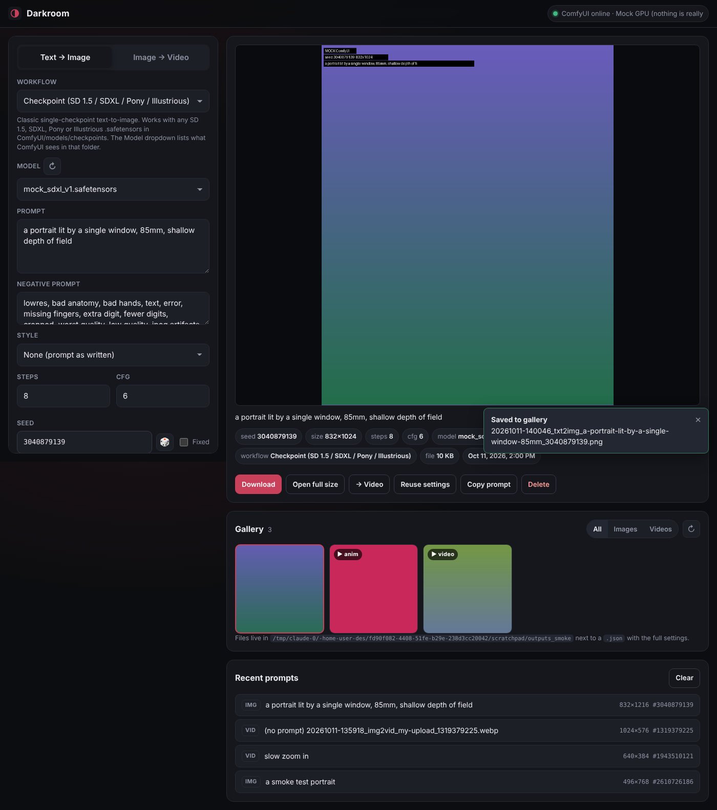

# Darkroom

A private, local-only web frontend for [ComfyUI](https://github.com/comfyanonymous/ComfyUI):
text → image and image → video with a dark, phone-friendly page, a gallery of everything you
make, and swappable workflow presets. Everything runs on your machine; nothing leaves it.

* Talks only to **your** ComfyUI at `http://127.0.0.1:8188` (configurable).
* No accounts, no analytics, no CDN, no fonts or scripts from the web. The page ships a
  Content-Security-Policy that makes the browser refuse to load anything that is not served by
  Darkroom itself, so even a future mistake cannot phone home.
* Listens on `127.0.0.1` only. Results are saved to `./outputs` with the prompt and seed next to
  them.



## Requirements

* **ComfyUI** installed and working (desktop app, portable build, or a git checkout) with at
  least one model, e.g. an SDXL / Pony / Illustrious checkpoint in `ComfyUI/models/checkpoints`.
  For video, the Wan 2.2 5B files (see [workflows/README.md](workflows/README.md)).
  Pony-family checkpoints: use the "CLIP skip 2" preset and the "Pony score tags" style.
* **Python 3.10 or newer** for Darkroom itself (any Python; it does not need to be ComfyUI's).
  On Windows, tick "Add python.exe to PATH" in the python.org installer.

Darkroom's own dependencies, all local libraries ([requirements.txt](requirements.txt)):
`fastapi`, `uvicorn`, `httpx`, `websockets`, `python-multipart`, `pillow`.

## Run it

**1. Start ComfyUI** the way you always do, and wait until it prints
`To see the GUI go to: http://127.0.0.1:8188`.

```sh
# git checkout
cd ComfyUI && python main.py
# Windows portable build: double-click run_nvidia_gpu.bat
# Desktop app: just open it. It listens on http://127.0.0.1:8000 (not 8188), so start
# Darkroom with  ./run.sh --comfy http://127.0.0.1:8000   (or set COMFY_URL=http://127.0.0.1:8000)
```

Keep ComfyUI on `127.0.0.1` (its default). Do not start it with `--listen`: ComfyUI has no login,
and it keeps its own copy of every Darkroom result and source image, so on `0.0.0.0` anyone on your
network could read them.

Live previews of the sampling steps appear in Darkroom automatically: it asks ComfyUI for
cheap latent previews per job. (Only very old ComfyUI builds ignore that request; there, start
ComfyUI with `--preview-method auto`.)

**2. Start Darkroom** (first run creates a `.venv` and installs the dependencies):

```sh
cd darkroom
./run.sh            # macOS / Linux
run.bat             # Windows (double-click works too)
```

or by hand:

```sh
cd darkroom
python3 -m venv .venv                            # Windows: py -3 -m venv .venv
.venv/bin/pip install -r requirements.txt        # Windows: .venv\Scripts\pip install -r requirements.txt
.venv/bin/python app.py                          # Windows: .venv\Scripts\python app.py
```

Your browser opens `http://127.0.0.1:8585`. The green dot top-right means ComfyUI is reachable;
a red banner tells you when it is not and what to do.

Options: `./run.sh --comfy http://127.0.0.1:8188 --port 8585 --outputs ./outputs --no-browser`
(`run.bat` passes options through the same way). The same can be set with the `COMFY_URL`,
`DARKROOM_PORT`, `DARKROOM_OUTPUTS` environment variables.

## Using it

**Text → Image.** Pick a workflow preset and a model (the dropdown lists the files ComfyUI
actually has), write the prompt and negative prompt, set steps / CFG / size, press
**Generate** (or Ctrl/⌘ + Enter). The progress bar follows ComfyUI's sampler; when the job
is done the image appears in the viewer and in the gallery, already saved to disk.

**Image → Video.** Drop an image on the box, paste one from the clipboard, or press **→ Video**
on any gallery image, then write a *motion prompt* ("slow push-in, hair moving in the wind").
Frames and FPS are per preset (Wan 2.2: 121 frames at 24 fps ≈ 5 s). The result plays in the
viewer; the source frame becomes its gallery thumbnail.

**Seed.** Empty = a new random seed each time. The seed that was used is shown after every job;
tick **Fixed** to keep it, 🎲 picks a new fixed one. **Reuse settings** on a result restores
everything including the seed. Note that ComfyUI caches node results: a fixed seed with
unchanged settings comes back instantly as the same image (Darkroom still saves a new copy).

**Style.** A preset that wraps your prompt ("{prompt}, cinematic still, film grain…"). Edit or
add styles in `presets/styles.json` (read once at start-up; restart Darkroom afterwards).

**Gallery.** Every result is saved as
`outputs/<date>-<time>_<mode>_<prompt snippet>_<seed>.<png|mp4|webp>` plus a `.json` with the
full settings. Thumbnails, filter by images/videos, download, delete, use as video source.

**Recent prompts.** The last 20 prompts (with their settings) in `outputs/history.json`.
Click one to load it.

**Cancel** interrupts the running job in ComfyUI or removes it from its queue.

## Swapping models and workflows

The Model dropdown already covers "same workflow, different checkpoint". For anything else
(LoRAs, Flux, Wan 2.2 14B, LTX-Video, custom nodes…) drop a ComfyUI *API-format* workflow into
`workflows/` with a few `{{TOKENS}}` and a small `_meta` block. It shows up in the Workflow
dropdown after a restart. The how-to, the token list and the `_meta` reference are in
[workflows/README.md](workflows/README.md); the top of [workflows.py](workflows.py) explains
the mechanism in the code.

## Files

```
app.py              the web server (FastAPI) and the /api routes; python app.py starts it
comfy_client.py     the ComfyUI client: /prompt, /ws progress + previews, /history, /view, /upload
workflows.py        loads workflows/*.json and fills the {{TOKENS}}
storage.py          outputs/ gallery, sidecar JSON, thumbnails, prompt history
workflows/          the presets (API-format ComfyUI graphs) and their README
presets/styles.json style presets
static/             the page: index.html, style.css, app.js (no build step, no dependencies)
dev/mock_comfyui.py a fake ComfyUI for trying the UI without a GPU (optional)
tests/              pytest suite (unit tests + an end-to-end run against the mock)
outputs/            your results (created on first run, ignored by git)
```

## Troubleshooting

| Message | What it means |
|---|---|
| **ComfyUI is not reachable at http://127.0.0.1:8188** | ComfyUI is not running, still loading, or on another port. ComfyUI Desktop uses port 8000: `./run.sh --comfy http://127.0.0.1:8000`. If the console of a git/portable ComfyUI prints another port, use that. |
| **Value not in list … ckpt_name: 'x' not in […]** | The preset's model file is not installed (or sits in the wrong `models/` subfolder). Pick another model in the dropdown or download the file; press ↻ next to Model after copying files. |
| **Node 'X' not found. The custom node may not be installed** (older ComfyUI: *Cannot execute because node X does not exist*) | Your ComfyUI is too old for that node (the video presets need CreateVideo/SaveVideo/Wan22ImageToVideoLatent: update ComfyUI) or a custom node is missing. |
| **… out of memory** | Lower width/height, frames or steps; close other GPU apps; use fp8 weights or the smaller preset. |
| **Finished but produced no files** | The workflow has no `SaveImage` / `SaveVideo` node (a `PreviewImage` is not enough). |
| Model dropdown is empty | ComfyUI is offline, or the folder named in the preset's `requires` is empty. |
| Live preview never appears | Your ComfyUI ignores the per-job preview request; start it with `--preview-method auto`. Everything else works without it. |

ComfyUI also keeps its own copy of each result in `ComfyUI/output/darkroom/` and the uploaded
source images in `ComfyUI/input/darkroom/` (the Desktop app: under its chosen base folder,
`Documents/ComfyUI` by default). Darkroom's Delete only removes its own copy in `./outputs`;
clear those ComfyUI folders yourself whenever you like.

## Privacy notes

* Darkroom binds to `127.0.0.1`. Starting it with `--host 0.0.0.0` would let other devices on
  your network use it; don't, unless that is what you want.
* The server makes exactly one kind of outbound connection: to the ComfyUI URL you configured.
  It ignores `HTTP_PROXY`-style environment variables so that cannot be redirected.
* The browser page cannot load anything from anywhere but Darkroom (CSP `default-src 'self'`).
* No telemetry anywhere in the stack. (This is also why Darkroom is a small FastAPI app rather
  than Gradio or Streamlit: both send usage analytics by default unless you remember to turn
  them off, and Gradio versions before 6.17 also pulled fonts and a script from CDNs.)
* The ComfyUI *server* (git checkout / portable build) has no telemetry. The ComfyUI **Desktop**
  app includes crash reporting and an optional "Send anonymous usage metrics" setting: decline it
  at install or turn it off in its settings. The ComfyUI *Manager* custom node fetches its node
  registry from the internet. None of this involves Darkroom.
* Your browser is the one component Darkroom does not control. Chrome and Edge, for example,
  contact their vendor's autofill service for any page that has a form, and do other profile-level
  background traffic. Use Firefox or Safari, or turn off "Save and fill addresses / payment
  methods" in Chrome's Autofill settings, if that matters to you.
* The page remembers your settings per preset in the browser: numbers and model names in
  `localStorage`, prompt text and seed only in `sessionStorage` (gone when the browser closes).
  The **Clear** button under Recent prompts also forgets the remembered prompt text.
* A short safety negative (`child, minor, underage, loli, shota`) is appended to every job
  server-side (`ALWAYS_NEGATIVE` in `app.py`). It costs nothing for adult content and keeps
  models from drifting somewhere illegal. For adults, depicting adults.

## Development

```sh
.venv/bin/pip install pytest
.venv/bin/python -m pytest             # unit tests + end-to-end test against the mock server
.venv/bin/python dev/mock_comfyui.py   # fake ComfyUI on :8188 to click around without a GPU
```
